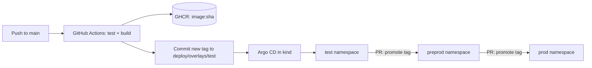

# gateway-bench — Design

Two API gateways with the **same features, same deployment, same benchmarks**:
one in **Rust** (axum + tower + hyper) and one in **Java 25** (Spring Cloud Gateway Server Web MVC on virtual threads).
The goal is learning first, numbers second: every phase teaches one concept in both languages side by side.

## 1. Features (identical in both gateways)

| Feature | Rust | Java |
|---|---|---|
| Path-based routing (`/users/**` → users upstream) | axum router + hyper client | Gateway Server MVC routes |
| JWT validation (RS256, JWKS from a static file/ConfigMap) | tower layer | gateway filter |
| Distributed rate limiting (token bucket in Redis, **same Lua script**) | tower layer + `redis` crate | `RedisRateLimiter`-compatible filter |
| Health probes (`/healthz`, `/readyz`) | axum handlers | Spring Boot Actuator |
| Metrics (Prometheus) | `metrics` + exporter | Micrometer |
| Tracing (OpenTelemetry, OTLP) | `tracing` + `opentelemetry` | Micrometer Tracing + OTLP |
| Structured JSON logs | `tracing-subscriber` | Logback JSON |
| Config from env / ConfigMap | `figment` or env | `application.yml` + env |
| Graceful shutdown | tokio signal + hyper drain | `server.shutdown=graceful` |

The concurrency model is the core comparison:
**tokio async tasks** (Rust) vs **virtual threads** (Java 25). Both let you write
straight-line code while handling many in-flight requests; scenario S4 tests exactly this.

## 2. Repository layout

```
gateway-bench/
├── gateway-rust/        # axum + tower gateway
├── gateway-java/        # Spring Boot 4 + Spring Cloud Gateway Server MVC, Java 25
├── upstream/            # tiny mock backend with configurable latency (shared by both)
├── bench/               # k6 scenarios, run scripts, results/ (CSV + charts)
├── deploy/              # Kustomize base + overlays (test, preprod, prod) — the "config repo"
│   ├── base/
│   └── overlays/{test,preprod,prod}/
├── .github/workflows/   # CI: test → build image → push to GHCR → bump tag in deploy/
└── docs/
```

`deploy/` lives in this repo to keep things simple. It is structured so it can be
split into its own repository later, mirroring a real GitOps setup.

## 3. Delivery flow (GitOps)



- **CI** builds images inside Docker (multi-stage). No local Rust or Java 25 install is needed.
- **Config and secrets**: ConfigMaps per overlay. Secrets (JWT keys, Redis password) start as
  plain Kubernetes Secrets for local learning; a later phase switches to Sealed Secrets.
- **Environments**: three namespaces in one local kind cluster stand in for three clusters.
  Promotion = a PR that changes the image tag in the next overlay.

## 4. Kubernetes design (identical for both gateways)

- Deployment, 2 replicas, same `requests`/`limits` (start: 1 CPU / 512Mi, tuned per overlay)
- Readiness + liveness probes, `preStop` hook for graceful drain
- HPA on CPU, PodDisruptionBudget (`minAvailable: 1`)
- Service (ClusterIP) + one Ingress per environment
- Redis as a single StatefulSet per environment (shared by both gateways' rate limiters)
- Prometheus + Grafana for metrics during benchmarks

## 5. Benchmarks

Same k6 scripts, same order, same resources for both gateways.

| ID | Scenario | What it shows |
|---|---|---|
| S1 | Passthrough (no auth, no limit), upstream 0 ms | Pure gateway overhead |
| S2 | Full chain: JWT + rate limit (limit set high) | Realistic request cost |
| S3 | Rate limit enforcement under burst | Correctness: share of 429s vs expected |
| S4 | Slow upstream (200 ms), high concurrency | tokio vs virtual threads under many in-flight requests |

Measured per run: RPS, p50/p95/p99 latency, error rate, CPU and memory per pod,
cold start time, container image size. Max sustainable RPS = highest rate with p99 under 50 ms
and errors under 0.1%.

**Fairness rules**
- Same CPU/memory limits, same replica count, same upstream, same Redis.
- Java gets a documented warm-up (JIT). Both **cold** and **warm** numbers are reported.
- Each scenario runs 3 times; the median is reported, all raw runs are committed.
- Hardware, versions, and kind's single-node limitation are written next to every result.
  Load generator and gateways share one machine locally, so absolute numbers are indicative;
  the comparison between the two is the point.

## 6. Phases

Each phase ends with something that runs and one short write-up of what was learned.

| # | Phase | Learn |
|---|---|---|
| 0 | Bootstrap: layout, upstream mock, Docker Compose, Makefile | Project setup in both ecosystems |
| 1 | Routing proxy in both + **first baseline benchmark (S1)** | Reverse proxy basics, connection pooling |
| 2 | JWT validation | Middleware/filter chains: tower layers vs gateway filters |
| 3 | Redis rate limiting (shared Lua script) | Distributed state, token bucket |
| 4 | Observability + graceful shutdown | Metrics, traces, probes |
| 5 | CI: GitHub Actions → GHCR | Multi-stage builds, image size, caching |
| 6 | kind + Argo CD + Kustomize overlays | GitOps, promotion between environments |
| 7 | Full benchmark suite in-cluster, charts, LinkedIn post | Measuring fairly, presenting results |

## 7. Open questions

- Upstream mock language (default: Rust, so it is never the bottleneck).
- Ingress controller for kind (default: ingress-nginx).
- When to move from plain Secrets to Sealed Secrets (default: phase 6).
