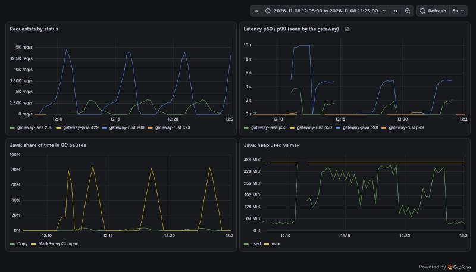

# Phase 4 — Observability and graceful shutdown

**Built:** both gateways now export Prometheus metrics, OpenTelemetry traces and JSON logs, and
the stack has Prometheus, Jaeger and a provisioned Grafana dashboard
([localhost:3000](http://localhost:3000)). Graceful shutdown, already in place since phase 0, is now tested.

*The S2 benchmark in Grafana. Each hump is one rate step. Java (bottom left) spends up to ~80 %
of its time in full GC pauses (MarkSweepCompact) while its heap sits at the 384 MiB ceiling.
Gaps in the Java panels are scrapes that timed out while the JVM was paused.*

| | Rust | Java |
|---|---|---|
| Metrics | `metrics` + `metrics-exporter-prometheus`, `/metrics` | Micrometer Prometheus registry, `/actuator/prometheus` |
| Admin port | second axum listener on 9090 (`/healthz`, `/metrics`) | `management.server.port: 9090` |
| Traces | `tracing` + `tracing-opentelemetry`, OTLP/HTTP | Micrometer Tracing → OpenTelemetry, OTLP/HTTP |
| Spans per request | 1 (server span) | 8 (security filter chain, auth, Redis `EVALSHA`, HTTP client, …) |
| Trace to upstream | `traceparent` injected by hand in the proxy | automatic (instrumented HTTP client) |
| Logs | `tracing-subscriber` JSON, `trace_id` from the request span | Spring Boot structured logging (ECS), `traceId` from MDC |
| Config | standard `OTEL_*` env vars, read by the SDK | same env vars, mapped by Spring Boot |

## Decisions (asked before building)

- **Prometheus + Grafana + Jaeger** as three separate containers, the same pieces we will run in
  Kubernetes, rather than one all-in-one image.
- **10 % parent-based sampling.** If the caller already decided (a sampled `traceparent`), we follow it.
- **No per-request access log.** Logs are for events (startup, warnings, errors); metrics and
  traces describe requests.

## What we learned

- **One set of `OTEL_*` variables configures both.** The Rust SDK reads `OTEL_SERVICE_NAME`,
  `OTEL_EXPORTER_OTLP_ENDPOINT`, `OTEL_TRACES_SAMPLER(_ARG)` itself; Spring Boot 4 maps them to
  its own properties. Compose sets them once for both gateways.
- **Same metric, same buckets, one query.** Rust records `http_server_requests_seconds` with the
  buckets Micrometer is told to use (`management.metrics.distribution.slo`), so one PromQL
  query draws both lines. Gotcha: Spring parses these as durations, and `2.5ms` is not a valid
  duration. `2500us` is.
- **Separate admin port.** Probes and metrics never go through the public Ingress. Spring needs
  one property; Rust needs a second listener. Spring's tests then need `@LocalManagementPort`,
  plus `@AutoConfigureMetrics`, because Spring disables metrics export in tests by default.
- **Java instruments everything by default.** Micrometer Observation creates spans for every
  security filter, the Redis call and the outgoing HTTP call: 8 spans per request against Rust's 1.
  Rich traces, but 8× the data to export and store.
- **Unsampled requests still carry a `traceparent`** (flag `00`), so services behind the gateway
  follow the same sampling decision. The upstream mock now echoes the header it received, and
  the logged trace id matches it in both gateways.
- **Graceful shutdown works in both.** `make smoke-shutdown` sends SIGTERM while a 3 s request is
  in flight: the request finishes with 200 and each gateway exits within ~3 s, long before
  Docker's kill timeout.

## Cost of observability (S2: JWT + rate limit + metrics + 10 % tracing, median of 3)

Raw data: [bench/results/s1/20261108-120823-s2](../../bench/results/s1/20261108-120823-s2/results.md),
against phase 3 ([20261108-100810-jwt-rl](../../bench/results/s1/20261108-100810-jwt-rl/results.md)).

| | rate | achieved | p50 | p99 | gateway CPU |
|---|---:|---:|---|---|---|
| rust | 10 000 | 10 000 → 9 999 | 0.26 → 0.32 ms | 4.35 → 6.40 ms | 75 → 91 % |
| rust | 20 000 | 19 967 → 19 450 | 0.39 → 0.67 ms | 7.71 → **123.9 ms** | 119 → 146 % |
| java | 5 000 | 4 992 → 4 997 | 0.52 → 0.58 ms | 17.25 → 15.06 ms | 162 → 181 % |
| java | 10 000 | 1 269 → 963 | 1 506 → 1 853 ms | 3 592 → 6 419 ms | 118 → 119 % |

**Rust at 20k rps now runs close to its 2-CPU limit**, and p99 jumps (22, 124 and 193 ms in the
three runs). We dug into why with short probes at 20k (two 30 s runs each, raw data in
[probes/](../../bench/results/s1/20261108-120823-s2/probes)):

| probe at 20k rps | avg CPU | p99 |
|---|---:|---|
| phase 3 binary, today's stack | 131–135 % | 17 ms |
| phase 4 binary | 155–156 % | 33–84 ms |
| phase 4, sampling 0 % (nothing exported) | 163–165 % | 28–140 ms |
| phase 4, request spans disabled (`RUST_LOG=warn`) | 151–157 % | 45–70 ms |

- About half the CPU increase is **the busier machine**: the phase 3 binary itself went from
  119 % to ~133 % with Prometheus, Jaeger and Grafana running next to it.
- The other half is **per-request instrumentation in the Rust gateway, roughly 11 µs per request**.
- **Not exporting spans changes nothing, and neither does disabling the span.** So the cost is
  not tracing. The remaining per-request work is the histogram record (label strings, key
  lookup; the exporter keeps raw samples until its 5 s upkeep). Not profiled yet. That is the
  next thing to measure, not a conclusion.
- **Java was already past its limit** at 10k (GC-bound); 8 spans per request made it worse
  (1 269 → 963 rps).

## Caveats

- Observability containers share the machine with the load generator, so S2 is measured on a
  busier host than earlier phases. The A/B probes above are the like-for-like comparison.
- Probes are two 30 s runs each, indicative only.
- Java's p99 line in Grafana is capped at 10 s, the highest histogram bucket.
